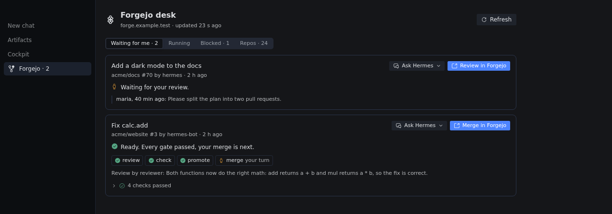
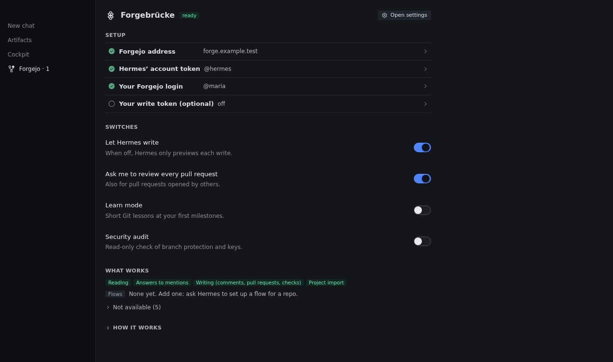

# Forgebrücke

**A bridge to your Forgejo.** Forgebrücke connects Hermes Agent to your self-hosted
[Forgejo](https://forgejo.org). Gitea works where its API matches. Hermes works there as its own
account on its own feature branches, and the merge into `main` stays yours.



Version 0.0.26. MIT. A Studio Luftbrücke Hermes plugin.

## What it does

- **Desk.** The pull requests that wait for you, each with its state in one sentence, in Desktop
  or `hermes forgebruecke desk`.
- **Parking.** Park a waiting pull request with a note only you see. It leaves the count and comes
  back on someone's comment, new commits, or when marked ready.
- **Chat and writes.** Ask about issues, pull requests, checks and repos. Writes follow Hermes'
  approval setting.
- **Receipts.** "Pushed", "opened" or "merged" in a reply is checked against Forgejo and marked ✓ or ❌.
- **Flows and mentions.** Per repo: agent review, checks, optional staging, then you. Hermes
  answers mentions of its account in the thread.
- **Repos and lessons.** Access, presets, audit, import, mirrors, templates, and short Git lessons.

## Install and update

Needs Hermes 0.23.0 or newer. Run the first line where Hermes runs; with Hermes on a server, the
second on the Desktop computer too.

```bash
hermes plugins install https://github.com/studioluftbruecke/hermes-forgebruecke --enable
hermes plugins install https://github.com/studioluftbruecke/hermes-forgebruecke
```

Then start a new chat. Update with `hermes plugins update forgebruecke` in the same places.

- The sidebar switch and position on the Forgebrücke settings page are kept per Desktop, so a second computer starts with the defaults.

## Hermes on a server

Desktop draws the desk and settings from its own computer, so both places need the same version:

- On the server, add `-p <profile>` to the install and update commands.
- Then Capabilities → Plugins → Rescan; switch a new Desktop half on.
- Tokens and settings go into the server profile only; the Desktop computer's copy needs none.
- After a server update, switch **Agent in <profile>** off and on there, then start a new chat.
- The mention channel needs `hermes gateway restart` on the server; off and on is not enough.
- Compare `hermes plugins list` on both computers.

## First use

1. **A Forgejo account for Hermes.** Create a user, for example `hermes`. Add it to each repo under
   Settings → Collaborators. Signed in as that user, create a token for all repositories with
   `read:notification`, `write:issue`, `write:repository`, `read:user`.
2. **Address, token and you.** In Hermes Desktop open Settings → Plugins → Forgebrücke. Enter your
   Forgejo address and Hermes' token. Then click "Use @your-name" on the Forgebrücke page, so the
   desk knows whose reviews to list.
3. **Let Hermes write.** A new setup only previews writes. Switch on "Let Hermes write". Then ask
   "What waits for me on Forgejo?"

The Forgebrücke page and `hermes forgebruecke doctor` name the next step.



Optional:

- **Merge and comment from the desk.** Add your write token, a token of your own account with
  `write:repository`, `read:user` and `write:issue`. It is also exposed to Hermes, ultimately giving
  Hermes full access to your account.
- **Git as Hermes' account.** `hermes forgebruecke git-credential` prints the three `git config` lines.
- **Mentions.** Run these two commands. The doctor names what is still missing.

  ```bash
  hermes -p <profile> config set platform_toolsets.forgebruecke '[forgebruecke]'
  hermes -p <profile> config set platforms.forgebruecke '{enabled: true}'
  ```

## Your rules

- **The merge is yours.** Nothing approves or merges `main`. A flow can merge only into an
  unprotected branch you named, such as `staging`.
- **Forgejo decides where.** Hermes reads and writes only where its account has access.
- **Writes follow Hermes' approval setting.** With approvals on, each write asks; with approvals
  off, writes go out unasked. Protect `main` so only you push and merge there.
- **Unattended runs do not write** (cron jobs, single-query runs, mention turns), except a flow you
  wrote and review requests to you.
- **A new commit or a changed flow is checked again.** A push or a higher flow `version` reruns
  every gate; a failed or edited gate reruns from there.
- **One flow per repo.** A rule that lists several flows runs only the first one.

## If something is wrong

- **Start with the doctor.** `hermes forgebruecke doctor` names the next step, and why a feature is
  not available.
- **A write changed nothing.** A new setup only previews. Switch on "Let Hermes write".
- **A write was refused.** The refusal names the missing access and links the repo's Collaborators page.
- **The desk lists no reviews.** Check that "You" is set (setup step 3).

## Settings

"You" and the four switches are on the Forgebrücke page. Everything else is in Hermes' settings.

| Setting | Default | What it does |
| --- | --- | --- |
| `url` | | Your Forgejo address |
| `token` (`FORGEBRUECKE_BOT_ACCOUNT_TOKEN`) | | Hermes' token |
| `you` | | Your Forgejo user name |
| `owner_token` (`FORGEBRUECKE_PERSONAL_WRITE_TOKEN`) | | Your write token, for the desk's Merge and Comment buttons |
| `dry_run` | on | Preview writes, send none |
| `review_every_pr` | on | Ask you to review every open pull request |
| `learn_mode` | off | Lesson cards |
| `audit_enabled` | off | Allow the read-only audit |
| `writes` | empty | One rule per repo: `repo_glob`, `flows`, `mentions`, `targets` |
| `flows_path` | `.forgebruecke/flows.yml` | Where a repo keeps its flow |
| `default_review_profile` | this profile | Profile that runs a flow's review; it needs Forgebrücke enabled |
| `mention_authors` | everyone with write access | Narrows whose mentions get an answer |
| `poll_interval` | 30 | Seconds between polls of Forgejo (30 to 3600) |

## Disclosures

- **Network.** Only your Forgejo, polled on your interval. The doctor also reads its
  `/swagger.v1.json`. While Desktop is visible, the desk page reads every 30 s and the settings
  page every 2 min. The sidebar count reads every minute, or your interval if longer. A hidden
  Desktop reads nothing. Remote HTTP URLs warn; use HTTPS outside localhost.
- **Scope detection.** The doctor learns a token's write scopes from requests Forgejo must reject:
  empty `POST`s and a `PATCH` of a missing notification. Only the settings page checks your write token.
- **Credentials.** Two tokens in your profile's `.env`, written by Hermes' settings. Any agent shell
  on that host can read them. The plugin never reads `FORGEJO_TOKEN` or another tool's token.
- **Writes, under Hermes' approval setting.**
  - Comments with an AI-disclosure footer, and line comments as a `COMMENT` review
  - Pull requests with labels and review requests
  - Checks on a commit
  - Flow and pack files, as a branch plus a pull request
  - Labels and protection presets
  - Imports into Hermes' account
  - Push mirrors. Forgejo stores Hermes' token in the mirror's settings
  - Repos from templates
- **Writes without a card.** Review requests to you (`review_every_pr`). A flow you wrote posts
  checks named `forgebruecke/<flow>/…`, one status comment per pull request and notify comments. Its
  `promote` gate opens a pull request and merges it into the branch the flow names. None of them
  with `dry_run` on.
- **Unattended agent turns.** A mention by someone with write access starts a turn without you. The
  turn gets only the tools `platform_toolsets.forgebruecke` names, reads only its thread's repo and
  cannot write through tools. Its answer is posted as Hermes' account. Issue and comment text is
  untrusted input. A tool list with the shell, file writes, code, memory, past-session search or an MCP
  toolset keeps the channel off. The channel posts only answers, into the thread of a mention from the last hour on
  a repo whose rule allows mentions. A cron delivery or `send_message` aimed at it is refused.
- **Background ticks.** While a flow or review requests are on, a loop in the Hermes gateway ticks
  every `poll_interval` seconds. A tick reads open pull requests, starts review workers and sends
  what a flow names. The mention channel ticks too. If neither runs, the settings page says so; then
  run `hermes -p <profile> forgebruecke tick` from cron, for example every five minutes.
- **Review workers.** A flow's review gate starts `hermes -p <profile> chat --query-file <prompt>
  -t no_mcp --ignore-rules -Q`, at most two at once. That profile must have Forgebrücke enabled;
  otherwise the gate ends in an error that names the command to enable it. The turn runs in that
  profile's gateway with its model. It gets no memory, `SOUL.md`, built-in toolsets or MCP servers.
  Hermes still offers it the tool-search bridge and the profile's plugin tools, and Forgebrücke
  refuses every call. The prompt holds the pull request's text and diff, which its author controls.
  The worker writes nothing; its answer is the verdict. Its summary and findings are posted on the
  pull request as plain text, cut to a fixed length. Links, issue and commit references, HTML and
  mentions in them are made inert.
- **The desk.** The page calls only this plugin's routes on your Hermes backend. Your write token
  merges (`/merge`, pinned to the shown commit) and reads your merge rights (`/desk`,
  `/repo-pulls`). `/comment` posts your words as you. `/park` and `/unpark` write only
  `parked.json`. `/setting` saves `you` and the four switches through `hermes config set`. "Create a
  reviewer profile" asks first. It runs `hermes profile create --clone-from`, which copies
  `config.yaml`, `SOUL.md` and the `.env` with all its keys. Then `hermes memory reset` erases the
  copy's memories and `hermes config unset` removes Forgebrücke's two tokens. `/reload-tokens` reads
  those two tokens again through Hermes' secret loader and keeps them in memory; it restarts
  nothing. "Ask Hermes" opens a chat with a draft and sends nothing. A process that can call these
  routes can do the same, so keep Hermes' approvals on.
- **Guard.** A tool call that would edit the profile's settings or secrets, this plugin's files or
  its data folder asks you first. The guard catches direct routes, not every script.
- **Git credential helper** (only where you set it up). It prints Hermes' token for your Forgejo
  address, nothing for another host, and never your write token. Git keeps no cached copy.
- **Process and state.** The plugin runs inside the Hermes gateway. Under `plugins.isolation: host`
  it loads without the mention channel. State, run records, `receipts.jsonl`, `desk-actions.jsonl`
  and `lessons.json` live in your profile's plugin data folder.
- **`@forgejo:` in any message expands**, including text you paste.
- No telemetry, no hosted service.

## Uninstall

Run `hermes plugins remove forgebruecke` in every place you installed it. The tokens in the
profile's `.env` and the plugin's data folder stay. Revoke the tokens in Forgejo.

## Contributing

See [CONTRIBUTING.md](CONTRIBUTING.md).

## License

MIT, see `LICENSE`. The Forgejo logo, used unmodified, is by Caesar Schinas and licensed CC BY-SA 4.0.
